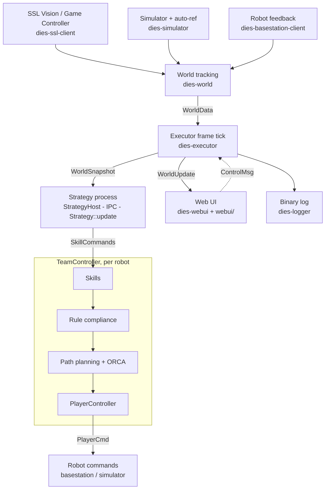

<p align="center">
<picture>
  <source media="(prefers-color-scheme: dark)" srcset="https://delftmercurians.nl/images/logo_dark.svg">
  
</picture>
</p>

<h1 align="center">🌩 Dies 🌩</h1>

In Roman mythology [Dies](<https://en.wikipedia.org/wiki/Dies_(mythology)>) (_dai-ez_) was the personification of day and the mother of Mercury.

Dies is the framework powering the [Delft Mercurians](https://delftmercurians.nl/)' RoboCup SSL AI. The core is written in Rust: vision and referee networking, world tracking, robot control and skills, a physics simulator with an auto-referee, binary logging, and a web UI. Strategies, the team-level logic that decides what each robot does, are separate Rust binaries that run in their own process and talk to the core over IPC, so they can be rebuilt and hot-swapped while Dies keeps running.

See [docs.delftmercurians.nl](http://docs.delftmercurians.nl/) for the full documentation.

## Getting Started

You'll need:

- A stable [Rust](https://www.rust-lang.org/tools/install) toolchain (use rustup).
- On Linux: `sudo apt install libudev-dev libssl-dev pkg-config clang`.

That's all for building and running Dies: the web UI bundle is committed in `crates/dies-webui/static` and served as-is.

```sh
cargo run -- --strategy concerto            # build the strategy once, run Dies in sim
cargo run -- --strategy concerto --watch    # rebuild + hot-swap the strategy on change
mprocs                                      # vite dev server + dies --watch (web UI work)
cargo run -- self-play --blue-strategy concerto --yellow-strategy concerto   # headless match
```

The web UI is served at <http://localhost:5555>. If you work on the frontend (`./webui`), you also need [`pnpm`](https://pnpm.io/): run `pnpm install` there once and use `mprocs` for hot module reloading. Before committing frontend changes, run `pnpm build` in `webui/` and commit `crates/dies-webui/static`. After changing Rust types shared with the UI, run `cargo run -p dies-webui --bin gen-bindings` and commit `webui/src/bindings.ts` (then `pnpm build` too: the bundle embeds `bindings.ts` for the notebook editor). CI checks that both are up to date and that `pnpm tsc` passes.

For hangs, [`tokio-console`](https://github.com/tokio-rs/console) (`cargo install --locked tokio-console`) attaches to a running Dies and shows task state.

## Codebase map

<!-- ANCHOR: map -->

The quickest way to find where a change belongs is to follow one frame of data through the system: from a camera packet to a robot command. The map below is organised along that path, not along the crate dependency graph.



### One frame, step by step

Everything is driven by a vision frame. In sim the loop steps the simulator and feeds its output through exactly the same entry points as real packets.

| # | Stage | Where | What happens |
|---|---|---|---|
| 1 | **Receive** | [`dies-ssl-client`][ssl-client], [`dies-basestation-client`][bs-client], [`dies-simulator`][sim] | Vision/referee packets arrive over UDP (or TCP); robot feedback (breakbeam, voltages, …) over the serial basestation. The simulator produces the same messages (`detection`, `gc_message`, `feedback`). |
| 2 | **Dispatch** | [`Executor`][executor] (`run_rt_live`, `run_rt_sim`, `step_simulation`, `run_headless`) | The main loop in `dies-executor` selects on all inputs and calls `update_from_vision_msg` / `update_from_gc_msg` / `update_from_bs_msg`. |
| 3 | **Track** | [`WorldTracker`][world-lib] | Kalman-filtered [players][world-player] and [ball][world-ball] ([filters][world-filter]), [game state][world-gs] from referee commands, and [possession][world-poss]. `WorldTracker::get()` yields a `WorldData` in **absolute** coordinates. |
| 4 | **Frame tick** | [`Executor::update_team_controller`][executor] | The heart of the system. Runs the steps below in order, once per vision frame. |
| 4a | Publish | same | Broadcasts a `WorldUpdate` to the web UI (absolute coordinates). |
| 4b | To team frame | [`WorldData::get_team_data`][core-world], [`sides.rs`][core-sides] | Converts to a team-relative frame (+x always toward the opponent goal). Everything downstream of this point is team-relative. |
| 4c | Strategy | [`StrategyHost`][host] → [`transform.rs`][transform] → [IPC][connection] → [runner][runner] → [`Strategy::update`][api-strategy] | Builds a [`WorldSnapshot`][proto-world], sends it to each team's strategy process, and collects [`SkillCommand`][proto-skill]s, roles and debug output. Strategies use [`TeamContext`][api-team] / [`PlayerHandle`][api-player] to issue commands. |
| 4d | Skills | [`TeamController`][team-ctrl] → [`SkillExecutor`][skill-exec], [`JointSkillExecutor`][joint-exec] | Each `SkillCommand` becomes a running [executable skill][skills] (`GoToPos`, `HandleBall`, `Receive`, …) that emits a `PlayerControlInput` per tick. Two-robot passes go through the [pass coordinator][pass-coord]. |
| 4e | Rules | `comply` in [`team_controller.rs`][team-ctrl] | Enforces game-state rules on every robot's input (stop distances, defense-area keep-outs, ball placement). Yellow-carded robots are benched earlier, by `plan_sidelining`, before the strategy runs. |
| 4f | Motion | [avoidance planner][avoid-planner], [ORCA][avoid-orca], [`PlayerController`][player-ctrl], [path follower][path-follower], [yaw control][yaw] | Plans a path around obstacles, follows it, deflects through ORCA, applies acceleration/velocity limits and dribbler/kicker logic. Produces a `PlayerCmd` and transforms it back to absolute coordinates. |
| 4g | Log | [`dies-logger` worker][log-worker] | Records the frame (world, debug values, raw feedback) to the columnar log. |
| 5 | **Send** | `Executor::player_commands` → `BasestationHandle::send_no_wait` / `Simulation::push_cmd` | Commands go out over radio, or into the simulator for its next step. |

### Side channels

- **Web UI control.** The [React app][webui] reads world/debug state over a WebSocket and sends commands via REST ([`api.tsx`][webui-api]). Backend: [`server.rs`][webui-server] / [`routes.rs`][webui-routes] → [`UiCommand`][webui-lib] → [`executor_task.rs`][webui-exec-task] → [`ExecutorHandle`/`ControlMsg`][exec-handle] → `Executor::handle_control_msg`. Rust types reach TypeScript through `ts-rs` (`#[derive(TS)]`), written into `webui/src/bindings.ts` by the [`gen-bindings`][webui-gen-bindings] binary.
- **Settings and tunables.** [`ExecutorSettings`][core-settings] (persisted in `dies-settings.json`) configures tracker, controller and avoidance. Skill knobs use the [`tunables!` macro][tunables-macro] ([`tunable.rs`][core-tunable]); strategy-declared parameters use [`params.rs`][core-params]. All are editable live from the UI.
- **Debug output.** Executor code draws/records with the global functions in [`debug_info.rs`][core-debug]; strategies use [`dies-strategy-api/src/debug.rs`][api-debug], which travels over IPC. Both end up in the UI and the log.
- **Logging and replay.** Schema in [`schema.rs`][log-schema]; logs land in `logs/`. [`replay.rs`][log-replay] + [`replay_controller.rs`][webui-replay] play a log back through the live UI channels. Offline analysis: [`tools/dieslog.py`][dieslog] and [`tools/match_analytics.py`][match-analytics].
- **Strategy lifecycle.** The CLI builds/watches strategy crates ([`dies-cli/src/strategy.rs`][cli-strategy]); `StrategyHost` spawns one process per team and hot-swaps it when the binary's mtime changes.
- **Headless self-play.** [`commands/self_play.rs`][cli-selfplay] → [`Executor::run_headless`][executor] ([`headless.rs`][headless]): a deterministic, faster-than-realtime sim match with no UI.
- **Entry point.** [`dies-cli`][cli] parses flags ([`cli.rs`][cli-args]) and starts the UI server, a self-play match, or a hardware test.

### Where do I change…?

| I want to… | Start here |
|---|---|
| Change team behaviour: who goes where, when to shoot or pass | [`strategies/concerto`][concerto]: [`planner.rs`][c-planner] (where the ball should go), [`driver.rs`][c-driver] (turns a plan into skills), [`formation.rs`][c-formation] (everyone else), [`keeper.rs`][c-keeper], [`penalty.rs`][c-penalty], constants in [`config.rs`][c-config] |
| Change how a robot does one thing (pick up the ball, aim, kick, receive) | [`dies-executor/src/skills/executable/`][skills], e.g. [`handle_ball/`][handle-ball] |
| Add a new skill | Variant in [`SkillCommand`][proto-skill] → builder in [`PlayerHandle`][api-player] / [`skill_builders.rs`][api-builders] → implementation in [`skills/executable/`][skills] → wire it up in `create_skill_from_command` ([`skill_executor.rs`][skill-exec]) |
| Change passing between two robots | [`pass_coordinator.rs`][pass-coord], [`joint_skill_executor.rs`][joint-exec], [`passing.rs`][passing] |
| Expose new world information to strategies | [`WorldData`][core-world] → [`create_world_snapshot`][transform] → [`WorldSnapshot`][proto-world] → [`World`][api-world] accessor |
| Fix noisy or laggy robot/ball estimates | [`dies-world/src/player.rs`][world-player], [`ball.rs`][world-ball], [`filter/`][world-filter], tuning in [`TrackerSettings`][core-settings] |
| Change who is considered to have the ball | [`dies-world/src/possession.rs`][world-poss] (types in [`dies-core/src/possession.rs`][core-poss]) |
| Change how referee commands map to game states | [`dies-world/src/game_state.rs`][world-gs], [`GameState`][core-world] |
| Change rule enforcement (stop distance, defense area, yellow cards) | `comply` and `plan_sidelining` in [`team_controller.rs`][team-ctrl] |
| Change obstacle avoidance or path planning | [`control/avoidance/`][avoidance] ([`planner.rs`][avoid-planner], [`orca.rs`][avoid-orca], [`obstacle.rs`][avoid-obstacle]), config in [`avoidance_config.rs`][core-avoid] |
| Change trajectory tracking, acceleration limits, dribbler ramp | [`player_controller.rs`][player-ctrl], [`path_follower.rs`][path-follower], [`yaw_control.rs`][yaw], [`motion_bounds.rs`][core-motion] |
| Change what is sent to the robots / the radio protocol | [`PlayerCmd`][core-player], [`basestation_client.rs`][bs-client] |
| Change simulator physics or auto-referee | [`dies-simulator/src/lib.rs`][sim] |
| Test a skill in isolation | [`strategies/scenarios`][scenarios] (one binary per scenario) |
| Add a web UI panel or view | [`webui/src/components/panels/`][webui-panels], [`webui/src/views/`][webui-views], data hooks in [`api.tsx`][webui-api] |
| Add a UI → executor command | [`UiCommand`][webui-lib] → [`executor_task.rs`][webui-exec-task] → [`ControlMsg`][exec-handle] → `Executor::handle_control_msg` ([`lib.rs`][executor]) |
| Add a REST endpoint | [`server.rs`][webui-server] + [`routes.rs`][webui-routes] |
| Add a runtime-tunable knob | [`tunables!`][tunables-macro] in the skill; generic settings in [`executor_settings.rs`][core-settings] |
| Change what gets logged | [`schema.rs`][log-schema], [`builders.rs`][log-builders], [`worker.rs`][log-worker]; reader in [`tools/dieslog.py`][dieslog] |
| Add a CLI flag or subcommand | [`cli.rs`][cli-args], [`commands/`][cli-commands] |
| Change in-match announcements | [`announcer.rs`][announcer] |

### Ground rules

- **Coordinates.** Strategies and controllers work in team-relative coordinates (+x toward the opponent goal). The tracker, simulator, UI and log use absolute vision coordinates. Conversion happens only at the boundaries listed above. Never expose absolute coordinates to a strategy.
- **Time.** Anything in the per-frame path (skills, controllers, FSMs) uses world time (`ctx.world.dt`, `t_received`), never `Instant`. The headless sim runs faster than realtime, so a wall-clock timer fires at the wrong moment and breaks determinism.
- **Dependencies.** [`dies-core`][core] holds shared types and nothing else. Feature crates depend on it, and [`dies-cli`][cli] glues them together. Strategy crates only see [`dies-strategy-api`][api].

[core]: https://github.com/DelftMercurians/Dies/tree/main/crates/dies-core
[core-world]: https://github.com/DelftMercurians/Dies/blob/main/crates/dies-core/src/world.rs
[core-sides]: https://github.com/DelftMercurians/Dies/blob/main/crates/dies-core/src/sides.rs
[core-settings]: https://github.com/DelftMercurians/Dies/blob/main/crates/dies-core/src/executor_settings.rs
[core-tunable]: https://github.com/DelftMercurians/Dies/blob/main/crates/dies-core/src/tunable.rs
[core-params]: https://github.com/DelftMercurians/Dies/blob/main/crates/dies-core/src/params.rs
[core-debug]: https://github.com/DelftMercurians/Dies/blob/main/crates/dies-core/src/debug_info.rs
[core-poss]: https://github.com/DelftMercurians/Dies/blob/main/crates/dies-core/src/possession.rs
[core-avoid]: https://github.com/DelftMercurians/Dies/blob/main/crates/dies-core/src/avoidance_config.rs
[core-motion]: https://github.com/DelftMercurians/Dies/blob/main/crates/dies-core/src/motion_bounds.rs
[core-player]: https://github.com/DelftMercurians/Dies/blob/main/crates/dies-core/src/player.rs
[tunables-macro]: https://github.com/DelftMercurians/Dies/blob/main/crates/dies-tunables-macro/src/lib.rs
[ssl-client]: https://github.com/DelftMercurians/Dies/blob/main/crates/dies-ssl-client/src/lib.rs
[bs-client]: https://github.com/DelftMercurians/Dies/blob/main/crates/dies-basestation-client/src/basestation_client.rs
[sim]: https://github.com/DelftMercurians/Dies/blob/main/crates/dies-simulator/src/lib.rs
[world-lib]: https://github.com/DelftMercurians/Dies/blob/main/crates/dies-world/src/lib.rs
[world-player]: https://github.com/DelftMercurians/Dies/blob/main/crates/dies-world/src/player.rs
[world-ball]: https://github.com/DelftMercurians/Dies/blob/main/crates/dies-world/src/ball.rs
[world-filter]: https://github.com/DelftMercurians/Dies/tree/main/crates/dies-world/src/filter
[world-gs]: https://github.com/DelftMercurians/Dies/blob/main/crates/dies-world/src/game_state.rs
[world-poss]: https://github.com/DelftMercurians/Dies/blob/main/crates/dies-world/src/possession.rs
[executor]: https://github.com/DelftMercurians/Dies/blob/main/crates/dies-executor/src/lib.rs
[exec-handle]: https://github.com/DelftMercurians/Dies/blob/main/crates/dies-executor/src/handle.rs
[headless]: https://github.com/DelftMercurians/Dies/blob/main/crates/dies-executor/src/headless.rs
[announcer]: https://github.com/DelftMercurians/Dies/blob/main/crates/dies-executor/src/announcer.rs
[host]: https://github.com/DelftMercurians/Dies/blob/main/crates/dies-executor/src/strategy_host/host.rs
[transform]: https://github.com/DelftMercurians/Dies/blob/main/crates/dies-executor/src/strategy_host/transform.rs
[connection]: https://github.com/DelftMercurians/Dies/blob/main/crates/dies-executor/src/strategy_host/connection.rs
[team-ctrl]: https://github.com/DelftMercurians/Dies/blob/main/crates/dies-executor/src/control/team_controller.rs
[skill-exec]: https://github.com/DelftMercurians/Dies/blob/main/crates/dies-executor/src/control/skill_executor.rs
[joint-exec]: https://github.com/DelftMercurians/Dies/blob/main/crates/dies-executor/src/control/joint_skill_executor.rs
[pass-coord]: https://github.com/DelftMercurians/Dies/blob/main/crates/dies-executor/src/control/pass_coordinator.rs
[passing]: https://github.com/DelftMercurians/Dies/blob/main/crates/dies-executor/src/control/passing.rs
[player-ctrl]: https://github.com/DelftMercurians/Dies/blob/main/crates/dies-executor/src/control/player_controller.rs
[path-follower]: https://github.com/DelftMercurians/Dies/blob/main/crates/dies-executor/src/control/path_follower.rs
[yaw]: https://github.com/DelftMercurians/Dies/blob/main/crates/dies-executor/src/control/yaw_control.rs
[avoidance]: https://github.com/DelftMercurians/Dies/tree/main/crates/dies-executor/src/control/avoidance
[avoid-planner]: https://github.com/DelftMercurians/Dies/blob/main/crates/dies-executor/src/control/avoidance/planner.rs
[avoid-orca]: https://github.com/DelftMercurians/Dies/blob/main/crates/dies-executor/src/control/avoidance/orca.rs
[avoid-obstacle]: https://github.com/DelftMercurians/Dies/blob/main/crates/dies-executor/src/control/avoidance/obstacle.rs
[skills]: https://github.com/DelftMercurians/Dies/tree/main/crates/dies-executor/src/skills/executable
[handle-ball]: https://github.com/DelftMercurians/Dies/tree/main/crates/dies-executor/src/skills/executable/handle_ball
[proto-skill]: https://github.com/DelftMercurians/Dies/blob/main/crates/dies-strategy-protocol/src/skill.rs
[proto-world]: https://github.com/DelftMercurians/Dies/blob/main/crates/dies-strategy-protocol/src/world.rs
[runner]: https://github.com/DelftMercurians/Dies/blob/main/crates/dies-strategy-runner/src/runner.rs
[api]: https://github.com/DelftMercurians/Dies/tree/main/crates/dies-strategy-api
[api-strategy]: https://github.com/DelftMercurians/Dies/blob/main/crates/dies-strategy-api/src/strategy.rs
[api-team]: https://github.com/DelftMercurians/Dies/blob/main/crates/dies-strategy-api/src/team.rs
[api-player]: https://github.com/DelftMercurians/Dies/blob/main/crates/dies-strategy-api/src/player.rs
[api-world]: https://github.com/DelftMercurians/Dies/blob/main/crates/dies-strategy-api/src/world.rs
[api-builders]: https://github.com/DelftMercurians/Dies/blob/main/crates/dies-strategy-api/src/skill_builders.rs
[api-debug]: https://github.com/DelftMercurians/Dies/blob/main/crates/dies-strategy-api/src/debug.rs
[concerto]: https://github.com/DelftMercurians/Dies/tree/main/strategies/concerto
[c-planner]: https://github.com/DelftMercurians/Dies/blob/main/strategies/concerto/src/planner.rs
[c-driver]: https://github.com/DelftMercurians/Dies/blob/main/strategies/concerto/src/driver.rs
[c-formation]: https://github.com/DelftMercurians/Dies/blob/main/strategies/concerto/src/formation.rs
[c-keeper]: https://github.com/DelftMercurians/Dies/blob/main/strategies/concerto/src/keeper.rs
[c-penalty]: https://github.com/DelftMercurians/Dies/blob/main/strategies/concerto/src/penalty.rs
[c-config]: https://github.com/DelftMercurians/Dies/blob/main/strategies/concerto/src/config.rs
[scenarios]: https://github.com/DelftMercurians/Dies/tree/main/strategies/scenarios
[log-schema]: https://github.com/DelftMercurians/Dies/blob/main/crates/dies-logger/src/schema.rs
[log-builders]: https://github.com/DelftMercurians/Dies/blob/main/crates/dies-logger/src/builders.rs
[log-worker]: https://github.com/DelftMercurians/Dies/blob/main/crates/dies-logger/src/worker.rs
[log-replay]: https://github.com/DelftMercurians/Dies/blob/main/crates/dies-logger/src/replay.rs
[dieslog]: https://github.com/DelftMercurians/Dies/blob/main/tools/dieslog.py
[match-analytics]: https://github.com/DelftMercurians/Dies/blob/main/tools/match_analytics.py
[webui]: https://github.com/DelftMercurians/Dies/tree/main/webui/src
[webui-api]: https://github.com/DelftMercurians/Dies/blob/main/webui/src/api.tsx
[webui-panels]: https://github.com/DelftMercurians/Dies/tree/main/webui/src/components/panels
[webui-views]: https://github.com/DelftMercurians/Dies/tree/main/webui/src/views
[webui-lib]: https://github.com/DelftMercurians/Dies/blob/main/crates/dies-webui/src/lib.rs
[webui-server]: https://github.com/DelftMercurians/Dies/blob/main/crates/dies-webui/src/server.rs
[webui-routes]: https://github.com/DelftMercurians/Dies/blob/main/crates/dies-webui/src/routes.rs
[webui-exec-task]: https://github.com/DelftMercurians/Dies/blob/main/crates/dies-webui/src/executor_task.rs
[webui-replay]: https://github.com/DelftMercurians/Dies/blob/main/crates/dies-webui/src/replay_controller.rs
[webui-gen-bindings]: https://github.com/DelftMercurians/Dies/blob/main/crates/dies-webui/src/bin/gen-bindings.rs
[cli]: https://github.com/DelftMercurians/Dies/tree/main/crates/dies-cli
[cli-args]: https://github.com/DelftMercurians/Dies/blob/main/crates/dies-cli/src/cli.rs
[cli-commands]: https://github.com/DelftMercurians/Dies/tree/main/crates/dies-cli/src/commands
[cli-strategy]: https://github.com/DelftMercurians/Dies/blob/main/crates/dies-cli/src/strategy.rs
[cli-selfplay]: https://github.com/DelftMercurians/Dies/blob/main/crates/dies-cli/src/commands/self_play.rs

<!-- ANCHOR_END: map -->

## Contributing

See the [developer guide](http://docs.delftmercurians.nl/dev.html) for conventions (branches, commits, error handling, logging).
